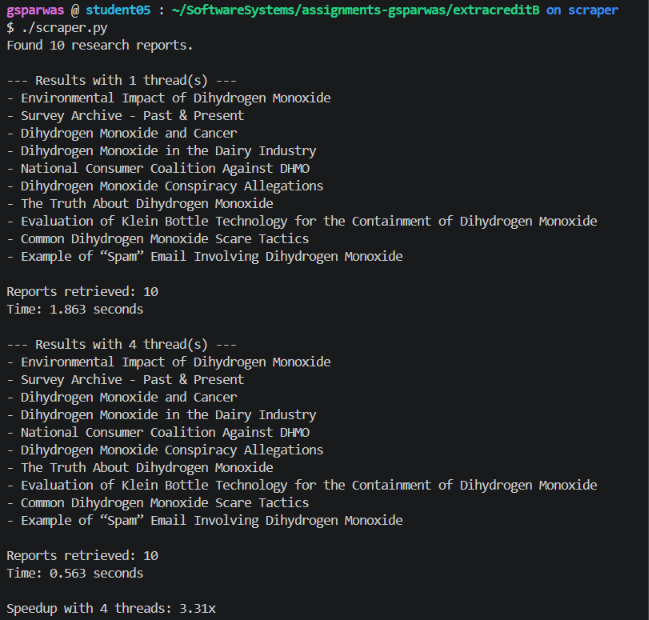

# DHMO Research Scraper

## Overview

This Python program scrapes research reports from [DHMO.org](https://www.dhmo.org/research.html). It collects links to research reports, visits each page, and extracts the report titles.

The scraper uses functional programming techniques, HTTP requests, and concurrent threads to compare the performance of sequential and concurrent web scraping.

## Usage

Run the scraper using:

./scraper.py

The program displays the report titles, the number of reports retrieved, and the execution time when using one thread versus four threads.

## Example Output

## Performance Analysis

The scraper uses `concurrent.futures.ThreadPoolExecutor` to download multiple research reports concurrently.

During one test, I recorded the following results:

1 Thread Execution Time: 2.050 seconds

4 Threads Execution Time: 0.622 seconds

Using four threads resulted in a speedup of approximately 3.30x.

The performance improved because web scraping involves waiting for HTTP responses. When using multiple threads, the program can make requests concurrently rather than waiting for each page to finish before starting the next one.

### Functional Programming

The scraper uses map(), filter(), and lambda functions to process URLs and report titles.

- map() transforms relative links into complete URLs.
- filter() selects links to research reports and removes invalid results.

Functional programming makes data processing more concise and organized, but it does not necessarily improve execution speed. The main performance improvement comes from using concurrent HTTP requests.

